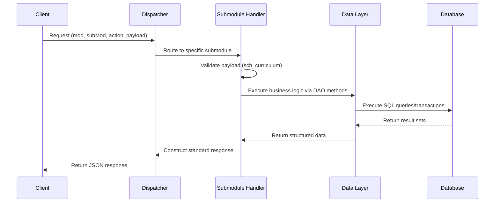

# Curriculum Implementation Blueprint

This document provides the internal implementation architecture of the OneApp Curriculum module (`m_curriculum`). It is intended to guide backend developers during the implementation phase. Any inferred architectural decisions are marked as **[INFERRED]**.

## 1. Module Overview
- **Responsibilities**: Defines and manages academic programmes, course catalogs, curriculum mapping, and student enrollment life cycles.
- **Ownership**: Primarily owns the `sch_academic_struct` schema.
- **Scope**: Programme definition, course definition, curriculum modeling, student enrollment into programmes, and semester registrations.
- **Excluded Responsibilities**: Fee collection, physical timetable scheduling, attendance tracking, examination conduct, and learning management system (LMS) content delivery.

## 2. Folder Structure
```text
modules/
└── m_curriculum/
    ├── manifest.py
    ├── db_init.py
    ├── sch_curriculum.py
    ├── m_curriculum_data.py
    ├── m_curriculum_sm_programme.py
    ├── m_curriculum_sm_course.py
    ├── m_curriculum_sm_curriculum.py
    ├── m_curriculum_sm_enrollment.py
```
- `manifest.py`: Defines module metadata, submodule routing maps, and cross-module dependencies.
- `db_init.py`: Initializes database connections, prepares ORM context, and registers `m_curriculum_data.py`.
- `sch_curriculum.py`: Contains validation schemas (e.g., Pydantic/Marshmallow) for all incoming API payloads.
- `m_curriculum_data.py`: The Data Access Object (DAO) layer responsible for executing SQL against PostgreSQL.
- `m_curriculum_sm_*.py`: Submodule handlers that process specific actions (add, view, update, delete) and execute business logic.

## 3. Runtime Flow


## 4. Shared Components
- **`manifest.py`**: Central registry read by the core Dispatcher during application startup to understand module capabilities.
- **`db_init.py`**: Shared initialization point that wires the transactional context from the core framework into the module's data layer.
- **`sch_curriculum.py`**: Shared validation logic. Handlers import schemas from this file to validate `actionType` specific payloads before executing business logic.
- **`m_curriculum_data.py`**: The sole interface to the database. Handlers must NEVER execute SQL directly; they must call methods exposed by this file.

## 5. Data Layer (`m_curriculum_data.py`)
Organized by entity. The implementation of these methods must handle PostgreSQL constraints and transactions.

### Programme
- `create_programme()`
- `update_programme()`
- `delete_programme()`
- `get_programme()`

### Course
- `create_course()`
- `update_course()`
- `delete_course()`
- `get_course()`
- `create_course_requisite()`
- `update_course_requisite()`
- `delete_course_requisite()`
- `get_course_requisite()`
- `[INFERRED] create_course_outcome()`
- `[INFERRED] get_course_outcome()`
- `[INFERRED] delete_course_outcome()`

### Curriculum
- `create_curriculum()`
- `update_curriculum()`
- `delete_curriculum()`
- `get_curriculum()`

### Enrollment
- `create_enrollment()`
- `update_enrollment()`
- `delete_enrollment()`
- `get_enrollment()`
- `create_semester_registration()`
- `update_semester_registration()`
- `delete_semester_registration()`

## 6. Submodule Blueprint

### `sm_programme`
- **Purpose**: Manages the lifecycle of academic programmes.
- **Responsibilities**: Creation, modification, and approval workflows for programmes.
- **Supported Actions**: `programme`, `programmeApproval`
- **Tables Owned**: `sch_academic_struct.tb_prog`
- **Dependent Tables**: `sch_org.tb_inst`, `sch_org.tb_dept`, `sch_lookup.tb_lookup`
- **DAO Methods Used**: Programme CRUD methods.
- **Validation Responsibilities**: Prevent duplicate programme names/codes; ensure valid lookup IDs for duration and type.
- **Cross-module Dependencies**: Organization, Lookup.
- **Expected Response Objects**: Standard API Envelope containing programme ID or lists of programmes.

### `sm_course`
- **Purpose**: Manages course catalogs and version histories.
- **Responsibilities**: Creation, modification, requisites, and outcomes for courses.
- **Supported Actions**: `courseDefinition`, `courseRequisite`, `courseOutcome`
- **Tables Owned**: `sch_academic_struct.tb_crs`, `tb_crs_version`, `tb_crs_prerequisite`, `tb_crs_corequisite`, `[INFERRED] tb_crs_outcome`
- **Dependent Tables**: `sch_lookup.tb_lookup`
- **DAO Methods Used**: Course CRUD and Requisite CRUD methods.
- **Validation Responsibilities**: Handle course version logic; prevent self-referencing requisites.
- **Cross-module Dependencies**: Lookup.
- **Expected Response Objects**: Standard API Envelope containing course versions and requisites.

### `sm_curriculum`
- **Purpose**: Binds courses to programmes across specific terms/semesters.
- **Responsibilities**: Creation, modification, and approval workflows for curricula.
- **Supported Actions**: `curriculumManagement`, `curriculumApproval`
- **Tables Owned**: `sch_academic_struct.tb_curr`, `tb_curr_version`, `tb_curr_term`, `tb_curr_term_crs`, `tb_elective_group`, `tb_elective_group_crs`
- **Dependent Tables**: `sch_academic_struct.tb_prog`, `sch_academic_struct.tb_crs_version`
- **DAO Methods Used**: Curriculum CRUD methods.
- **Validation Responsibilities**: Ensure term maps correctly to programme duration; enforce correct course versions.
- **Cross-module Dependencies**: None (all dependencies internal to `m_curriculum`).
- **Expected Response Objects**: Standard API Envelope containing deep-nested curriculum mapping.

### `sm_enrollment`
- **Purpose**: Manages student assignment to programmes and terms.
- **Responsibilities**: Enrollment root records, semester course registration, elective picks.
- **Supported Actions**: `enrollment`, `semesterRegistration`, `electiveRegistration`
- **Tables Owned**: None directly in `sch_academic_struct`.
- **Dependent Tables**: `sch_student.tb_stud_enrollment`, `sch_course_delivery.tb_stud_crs_registration`, `sch_course_delivery.tb_crs_offering`
- **DAO Methods Used**: Enrollment and Registration CRUD methods.
- **Validation Responsibilities**: Prerequisite validation, capacity checks, duplicate registration checks.
- **Cross-module Dependencies**: Student, Course Delivery.
- **Expected Response Objects**: Standard API Envelope containing registration IDs and enrollment statuses.

## 7. Validation Strategy
1. **Framework Validation**: The core dispatcher validates the standard envelope format and auth tokens.
2. **Payload Validation**: `sch_curriculum.py` validates required fields, types, and length limits.
3. **Lookup Validation**: Handlers verify lookup IDs against `sch_lookup.tb_lookup`.
4. **Business Validation**: Handlers enforce logic (e.g. prerequisite checks, elective capacity).
5. **Database Validation**: Data layer relies on PostgreSQL constraints (Unique, FK, Check).
6. **Response Generation**: Handler surfaces human-readable error if validation fails.

## 8. Transaction Strategy
- **Read-only operations**: Managed outside of strict write-locks; utilizes standard SELECT.
- **Single-table transactions**: Managed implicitly by simple INSERT/UPDATE statements.
- **Multi-table transactions**: (e.g., Curriculum + Terms + Courses) must be wrapped in `BEGIN`, `COMMIT`, `ROLLBACK` blocks within `m_curriculum_data.py`.
- **Cross-schema operations**: (e.g., Enrollment writes to `sch_student` and `sch_course_delivery`) must utilize a unified transactional context.
- **Rollback expectations**: Any foreign key failure or business rule failure during a multi-insert must trigger an absolute rollback.

## 9. Versioning Strategy
- **Applicable modules**: `sm_course`, `sm_curriculum`.
- **Current version**: Represented by `is_current = True` in `tb_crs_version` and `tb_curr_version`.
- **Historical version**: Maintained for referential integrity of past student enrollments. Old versions are marked `is_current = False`.
- **Version ownership**: Handled entirely at the application layer. The Handler and DAO must coordinate to insert new rows into version tables instead of overwriting existing published records.

## 10. Security Flow
- **Authentication**: Delegated to AAA module before the request reaches the Curriculum handler.
- **Authorization**: Handled via standard role-based access controls.
- **Permission verification**: The Dispatcher verifies if the user holds the requisite permission (e.g., `PROGRAMME_CREATE`) before invoking the handler.
- **Institution isolation**: Data must be scoped to the caller's `institutionId`.
- **Role validation**: Submodule handlers verify if the caller has authority over specific `departmentId` contexts where applicable.

## 11. Audit Strategy
- **Audit ownership**: The data layer is responsible for appending audit metadata.
- **Audit fields**: `created_on`, `created_by`, `updated_on`, `updated_by`.
- **Logging responsibilities**: Action state changes (approvals/rejections) should be logged.
- **Audit trail expectations**: **[INFERRED]** As several core tables (`tb_prog`, `tb_crs`) lack audit columns in the database, audit tracking may rely on an external logging service or those columns must be added via DDL modifications.

## 12. Module Dependencies
| Module | Why it exists | APIs requiring it | Mandatory |
| --- | --- | --- | --- |
| **AAA** | Authentication/Authorization, fetching `userId` | All | Yes |
| **Organization** | Fetching `institutionId`, `departmentId` | `programme`, `courseDefinition` | Yes |
| **Lookup** | Validating domain types (e.g. Duration, Status) | `programme`, `courseDefinition` | Yes |
| **Student** | Creating the base enrollment root record | `enrollment` | Yes |
| **Course Delivery** | Writing semester class registrations | `semesterRegistration`, `electiveRegistration` | Yes |
| **Notification** | **[INFERRED]** Alerting users on approvals | `programmeApproval`, `curriculumApproval` | No |
| **Document** | **[INFERRED]** Storing syllabus PDFs | `courseDefinition` | No |

## 13. Error Handling Strategy
- **Validation failures**: Caught early in `sch_curriculum.py`.
- **Constraint violations**: Caught by Data Layer; mapped to readable format.
- **Permission failures**: Blocked by Dispatcher.
- **Cross-module failures**: e.g., missing Lookup ID gracefully handled by DAO.
- **Database failures**: Connection drops throw 500 internal errors.

## 14. Implementation Order
1. `manifest.py` (Defines module presence)
2. `db_init.py` (Establishes connection capabilities)
3. `sch_curriculum.py` (Drafts the expected payload shapes)
4. `m_curriculum_data.py` (Build the DAOs starting with Programme, then Course)
5. `sm_programme` (Handler logic)
6. `sm_course` (Handler logic)
7. `sm_curriculum` (Handler logic - depends on Programme and Course)
8. `sm_enrollment` (Handler logic - depends on Curriculum mapping)
9. Tests

*Why this order?* Building schemas and DAOs first ensures the handlers have a solid foundation to call. Building Programme and Course before Curriculum ensures the foreign key references exist before attempting to map them.

## 15. Developer Checklist
- [ ] `manifest.py` completed and registered
- [ ] `db_init.py` configured
- [ ] Pydantic/Marshmallow schemas written in `sch_curriculum.py`
- [ ] DAO methods implemented in `m_curriculum_data.py`
- [ ] `sm_programme` CRUD handlers implemented
- [ ] `sm_course` CRUD handlers implemented
- [ ] `sm_curriculum` CRUD handlers implemented
- [ ] `sm_enrollment` CRUD handlers implemented
- [ ] Cross-module transactions verified
- [ ] Versioning logic explicitly tested
- [ ] API contract verified against payloads
