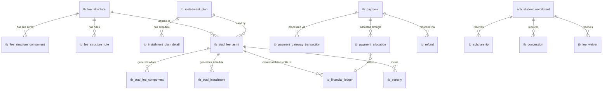

# OneApp m_fees — Database Discovery & Architecture Analysis

## 1. Executive Summary
The database architecture for the OneApp Fees module has been successfully analyzed. The entire fee management domain is encapsulated within a single schema: `sch_fees`, containing 18 well-normalized tables. 

The architecture supports complex fee structures, rule-based fee assignments, installment plans, multidimensional concessions (scholarships, waivers), penalty applications, and a robust financial ledger system for tracking debits, credits, and running balances. Notably, there is no explicit `tb_invoice` table; instead, the system utilizes `tb_stud_fee_asmt` (Student Fee Assessment) paired with `tb_financial_ledger` to serve the logical function of an invoice and statement of account. 

## 2. Schema Discovery
A comprehensive search across all PostgreSQL schemas reveals that fee-related tables are strictly localized to `sch_fees`. 
- **Primary Schema**: `sch_fees` (18 tables)
- **External Schemas Referenced**: 
  - `sch_student` (Student enrollments)
  - `sch_academic_struct` (Academic years, programs, batches, terms)
  - `sch_org` (Institution details)
  - `sch_core` (Document Management System - DMS)
  - `sch_lookup` (Master lookup values)
  - `sch_iam` (User auditing)

No legacy or duplicate tables were found in other schemas like `sch_finance` or `sch_payment` (which do not exist).

## 3. Table Inventory

All tables follow a consistent audit and soft-delete pattern: `status_id` (smallint), `is_active` (boolean), `created_by` (bigint), `created_on` (timestamptz), `updated_by` (bigint), `updated_on` (timestamptz).

### Fee Structure
- **`tb_fee_structure`**: Master record for a fee template. (PK: `id`). FKs to `sch_org.tb_inst`, `sch_academic_struct.tb_acad_year`. Includes `effective_from` and `effective_to` for versioning.
- **`tb_fee_structure_component`**: The line items of a fee structure (e.g., Tuition, Transport). Attributes: `amount`, `is_refundable`, `is_optional`.
- **`tb_fee_structure_rule`**: Defines the applicability of a fee structure (Prog, Batch, Category, Quota). Prioritized via `priority`.
- **`tb_installment_plan`**: Master table for installment configurations. 
- **`tb_installment_plan_detail`**: Defines the schedule, `due_date`, `percentage`, and `fixed_amount` for each installment.

### Fee Assignment (Logical Invoice)
- **`tb_stud_fee_asmt`**: Associates a student enrollment with a fee structure and an installment plan for an academic term. **This acts as the Invoice Header.**
- **`tb_stud_fee_component`**: The specific line items assessed for the student. **Acts as Invoice Line Items.**
- **`tb_stud_installment`**: The calculated schedule of payments due for the student.
- **`tb_financial_ledger`**: The transactional ledger tracking `debit_amount`, `credit_amount`, and `running_balance`. Links to `tb_stud_fee_asmt`.

### Concessions & Scholarships
- **`tb_scholarship`**: Tracks scholarship awards. Attributes: `amount`, `sanction_date`, `approval_status_id`, `doc_id` (supporting document).
- **`tb_concession`**: Tracks manual/category concessions.
- **`tb_fee_waiver`**: Tracks fee waivers.

### Payment & Refunds
- **`tb_payment`**: Master payment record. Includes `payment_method_id`, `payment_gateway_id`, `transaction_reference`, `total_amount`, `receipt_number`, `doc_id`.
- **`tb_payment_allocation`**: Junction table that allocates a single payment across multiple `tb_financial_ledger` entries.
- **`tb_payment_gateway_transaction`**: Tracks raw PG data (`gateway_order_id`, `gateway_payment_id`, `gateway_response_date`).
- **`tb_refund`**: Tracks refunds linked to a specific `payment_id` and `stud_enrollment_id`.

### Penalties & Holds
- **`tb_penalty`**: Tracks applied penalties (late fees). Linked to `tb_stud_fee_asmt`.
- **`tb_financial_hold`**: Places restrictions (e.g., block exam registration) on a student due to unpaid dues.

## 4. Relationship Diagram



## 5. Submodule Ownership

- **`sm_feeStructure`**: `tb_fee_structure`, `tb_fee_structure_component`, `tb_fee_structure_rule`, `tb_installment_plan`, `tb_installment_plan_detail`
- **`sm_feeAssignment`**: `tb_stud_fee_asmt`, `tb_stud_fee_component`, `tb_stud_installment`
- **`sm_concession`**: `tb_scholarship`, `tb_concession`, `tb_fee_waiver`
- **`sm_invoice`**: None (relies on `tb_stud_fee_asmt` and `tb_financial_ledger`)
- **`sm_payment`**: `tb_payment`, `tb_payment_allocation`, `tb_payment_gateway_transaction`, `tb_financial_ledger` (shared)
- **`sm_refund`**: `tb_refund`
- **`sm_penalty`**: `tb_penalty`, `tb_financial_hold`

## 6. Versioning Analysis
The schema supports fee structure versioning via **effective dates**:
- `tb_fee_structure` contains `effective_from` (date) and `effective_to` (date) columns.
- Academic year versioning is supported via `acad_year_id` FK.
- Status workflows (Draft/Published) are managed via `status_id` linked to `sch_lookup`.
- Immutable historical snapshots are implicitly supported; once `tb_stud_fee_asmt` is generated, changing the master structure doesn't affect existing assessments unless explicitly recalculated.

## 7. External Dependencies
- **Student**: `sch_student.tb_stud_enrollment` is the anchor for all student-level fee records.
- **Academic Structure**: `sch_academic_struct.tb_acad_year`, `tb_acad_term`, `tb_prog`, `tb_batch` are used in rules and assessments.
- **Organization**: `sch_org.tb_inst` anchors fee structures and installment plans.
- **Documents**: `sch_core.tb_dms` is referenced by `doc_id` in payments, concessions, and scholarships for receipts and approvals.
- **Master Data**: `sch_lookup.tb_lookup` is extensively used for all types and statuses (Payment Methods, Gateways, Statuses).
- **Users**: `sch_iam.tb_user` is used for all audit fields (`created_by`, `updated_by`) and approval workflows (`approved_by`, `released_by`).

## 8. Data Integrity Review
- **Missing Foreign Keys**: None detected. All tables are strictly constrained to other schemas.
- **Missing Tables**: There is no explicit `tb_invoice`. While `tb_stud_fee_asmt` serves this purpose, PDF invoice generation and specific invoice numbering will need to be derived or stored in a separate document/metadata system.
- **Redundancy**: `tb_scholarship`, `tb_concession`, and `tb_fee_waiver` are structurally identical. This is a deliberate denormalization for business capability separation, which is acceptable but could lead to duplicated logic in the backend.
- **Circular References**: None found. The ledger acts as the central settlement point (`tb_payment_allocation` -> `tb_financial_ledger`).

## 9. Backend Readiness Assessment

| Submodule | Readiness | Reason |
| :--- | :--- | :--- |
| **sm_feeStructure** | ✅ Ready | Complete schema support for rules, components, and installment definitions. |
| **sm_feeAssignment**| ✅ Ready | Robust assessment and ledger generation support. |
| **sm_concession**   | ✅ Ready | Tables exist for all 3 variations (Scholarship, Concession, Waiver). |
| **sm_invoice**      | ⚠️ Partially Ready | No explicit invoice table. Backend must dynamically generate invoices from `tb_stud_fee_asmt`, `tb_stud_fee_component`, and `tb_financial_ledger`. Invoice numbers might need a sequence generator logic. |
| **sm_payment**      | ✅ Ready | Excellent support for multiple gateways, split allocations, and receipts. |
| **sm_refund**       | ✅ Ready | Linked directly to the payment and approval workflow. |
| **sm_penalty**      | ✅ Ready | Penalty records and financial holds are fully supported. |

## 10. Recommended `db_init.py` Entity Mapping

```python
# m_fees/db_init.py

class SchFees(BaseSchema):
    __schema_name__ = "sch_fees"
    
    # Fee Structure
    TB_FEE_STRUCTURE = "tb_fee_structure"
    TB_FEE_STRUCTURE_COMPONENT = "tb_fee_structure_component"
    TB_FEE_STRUCTURE_RULE = "tb_fee_structure_rule"
    TB_INSTALLMENT_PLAN = "tb_installment_plan"
    TB_INSTALLMENT_PLAN_DETAIL = "tb_installment_plan_detail"
    
    # Fee Assignment
    TB_STUD_FEE_ASMT = "tb_stud_fee_asmt"
    TB_STUD_FEE_COMPONENT = "tb_stud_fee_component"
    TB_STUD_INSTALLMENT = "tb_stud_installment"
    
    # Ledger
    TB_FINANCIAL_LEDGER = "tb_financial_ledger"
    
    # Payment
    TB_PAYMENT = "tb_payment"
    TB_PAYMENT_ALLOCATION = "tb_payment_allocation"
    TB_PAYMENT_GATEWAY_TRANSACTION = "tb_payment_gateway_transaction"
    
    # Concessions
    TB_SCHOLARSHIP = "tb_scholarship"
    TB_CONCESSION = "tb_concession"
    TB_FEE_WAIVER = "tb_fee_waiver"
    
    # Penalty & Refund
    TB_PENALTY = "tb_penalty"
    TB_REFUND = "tb_refund"
    TB_FINANCIAL_HOLD = "tb_financial_hold"
```

## 11. Recommended `m_fees_data.py` Structure
The data access layer should be structured around the primary aggregates:
1. `FeeStructureData`: Manages structure, components, and rules as a single aggregate.
2. `InstallmentPlanData`: Manages plans and detail schedules.
3. `StudentFeeData`: Handles assessment generation, linking to the ledger.
4. `PaymentData`: Handles payment orchestration, PG transactions, and ledger allocations.
5. `ConcessionData`: Unified class for scholarships, concessions, and waivers due to table similarity.

## 12. Risks Before Implementation
1. **Invoice Numbering**: Without `tb_invoice.invoice_number`, the backend must implement a gapless sequence generator for compliance purposes (e.g., using a dedicated `sch_core.tb_sequence` or dynamically generating upon PDF creation).
2. **Concession Stacking**: The database does not explicitly define stacking rules (e.g., can a student have both a scholarship and a waiver?). The backend `sm_concession` module must enforce these business rules via code.
3. **Ledger Concurrency**: The `running_balance` column in `tb_financial_ledger` is vulnerable to race conditions if multiple payments occur simultaneously. Database row-locks (`SELECT FOR UPDATE`) or a strictly append-only derivation logic will be required in `sm_payment`.
